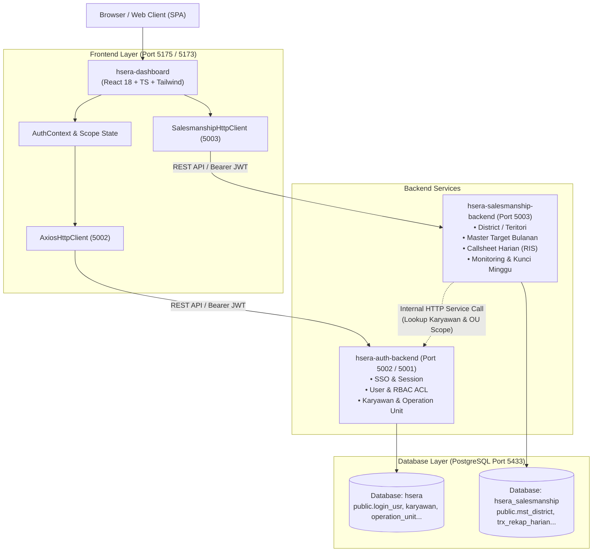

# Arsitektur Sistem HSERA

> **Tujuan Dokumen**: Dokumen ini menjelaskan prinsip Clean Architecture pada frontend `hsera-dashboard`, pemisahan microservice, alur autentikasi token JWT, mekanisme scoping wilayah kerja, serta sistem otorisasi RBAC berbasis bitmask.

---

## 1. Diagram Arsitektur Tingkat Tinggi



---

## 2. Clean Architecture di `hsera-dashboard`

Frontend `hsera-dashboard` menerapkan arsitektur bersih (*Clean Architecture*) dengan pemisahan tegas antara logika bisnis dan tampilan antarmuka:

```
src/
├── core/
│   ├── domain/               # LAPISAN 1: Aturan bisnis inti murni (tanpa React/Axios)
│   │   ├── models/           # Entity domain (User, District, Target, Callsheet, Monitoring)
│   │   ├── repositories/     # Interface kontrak repository (ISalesmanshipRepository, dll)
│   │   ├── permissions.ts    # Evaluasi bitmask hak akses ACL
│   │   └── errors/           # AppError normalisasi
│   ├── use-cases/            # LAPISAN 2: Alur proses bisnis spesifik aplikasi
│   │   ├── karyawan/
│   │   ├── operation-unit/
│   │   └── management/
│   ├── infrastructure/       # LAPISAN 3: Adapter ke dunia luar (HTTP, LocalStorage)
│   │   ├── api/              # AxiosHttpClient, SalesmanshipHttpClient, environment
│   │   ├── dto/              # Kontrak bentuk data mentah JSON API backend
│   │   ├── mappers/          # Pemetaan DTO <-> Domain Entity
│   │   └── repositories/     # Implementasi konkret repository (HttpSalesmanshipRepository)
│   └── di/
│       └── container.ts      # COMPOSITION ROOT: Instansiasi repository & use case
└── presentation/             # LAPISAN 4: UI, Komponen React, Hook, Halaman, Theme
    ├── components/           # ui/, form/, layout/
    ├── context/              # AuthContext, ToastContext
    └── pages/                # Modul per fitur (Salesmanship, Master, Settings, dll)
```

### Aturan Dependensi (Dependency Rule)
1. **Domain** tidak boleh mengimpor lapisan lain (`infrastructure`, `use-cases`, atau `presentation`).
2. **Use Cases** hanya bergantung pada **Domain** (model dan interface repository).
3. **Infrastructure** mengimplementasikan interface repository domain dan menerjemahkan error eksternal menjadi `AppError`.
4. **Presentation** berinteraksi dengan core hanya melalui `useCases` atau instance repository yang diekspos oleh `core/di/container.ts`. Komponen UI dilarang menginstansiasi `new HttpRepository()` secara langsung.
5. Aturan batas ini ditegakkan secara otomatis melalui linter ESLint (`.eslintrc.cjs` dengan `eslint-plugin-boundaries`).

---

## 3. Alur Autentikasi & Struktur Token JWT

### Siklus Autentikasi
1. Pengguna memasukkan username & password pada `/login`.
2. `LoginUseCase` pada Auth Backend memverifikasi hash password (mendukung hash bcrypt baru serta legacy SHA1), mengambil data relasi karyawan, serta menghitung hierarki unit operasional (OU).
3. Backend mengembalikan:
   * **Access Token** (JWT, masa berlaku singkat 15 menit).
   * **Refresh Token** (Opaque string, disimpan pada HttpOnly cookie dan database `user_session`).
4. Frontend menyimpan token ke `localStorage` dan mendecode klaim token via `jwtDecode()`.
5. Interceptor Axios pada [AxiosHttpClient.ts](file:///Users/dyra/Documents/Docker/hsera/hsera-dashboard/src/core/infrastructure/api/AxiosHttpClient.ts) dan [SalesmanshipHttpClient.ts](file:///Users/dyra/Documents/Docker/hsera/hsera-dashboard/src/core/infrastructure/api/SalesmanshipHttpClient.ts) secara otomatis menyertakan header:
   ```http
   Authorization: Bearer <accessToken>
   ```
6. Jika access token kedaluwarsa (HTTP 401), interceptor secara transparan meminta token baru melalui `POST /api/auth/refresh`.

### Struktur Payload Token JWT
```json
{
  "sub": "ad20720c-506f-4368-9a75-cf01ce8418ba",
  "username": "adys",
  "jenis": "pegawai",
  "idRelasi": "80a8ed23-d0fa-4633-aeb6-c1c7cd632950",
  "karyawan": {
    "id": "80a8ed23-d0fa-4633-aeb6-c1c7cd632950",
    "employeeNumber": "202609222",
    "nik": "3504052502910002",
    "legalName": "ADY SUPRAPTO",
    "operationUnitId": "891c0106-4199-46eb-a38c-f49fbcc28c35",
    "unitName": "Cabang Tulungagung",
    "unitType": "OPERATION_UNIT",
    "breadcrumb": "Kantor Pusat Nasional > Regional Jawa Timur > Area Office Tulungagung > Cabang Tulungagung"
  },
  "scope": {
    "isSuperAdmin": false,
    "unitId": "891c0106-4199-46eb-a38c-f49fbcc28c35",
    "unitCode": "CAB-TAG",
    "unitName": "Cabang Tulungagung",
    "unitType": "OPERATION_UNIT",
    "allowedUnitIds": [
      "891c0106-4199-46eb-a38c-f49fbcc28c35"
    ]
  },
  "permissions": [
    { "menuId": "d1000000-0000-4000-d000-000000000001", "enable": true, "level": 1111 },
    { "menuId": "2cc8cdbd-c155-48fc-a5e5-f72dafab86d6", "enable": true, "level": 1111 }
  ],
  "iat": 1792110841,
  "exp": 1792111741
}
```

---

## 4. Mekanisme Scoping Hierarki Organisasi (OU Scoping)

Organisasi HSERA menggunakan pohon hierarki 4 tingkat:
`HEAD_OFFICE` (Kantor Pusat) $\rightarrow$ `REGIONAL` $\rightarrow$ `AREA_OFFICE` $\rightarrow$ `OPERATION_UNIT` (Cabang).

Prinsip Scoping Akses Data:
1. **Super Admin (`isSuperAdmin: true`)**:
   * Memiliki akses global tanpa batasan unit.
   * `allowedUnitIds` mencakup seluruh unit di Indonesia.
2. **Pejabat Area / Regional (misal Area Manager `agoesm`)**:
   * Unit penempatan: `AREA-TAG`.
   * Otomatis memperoleh hak akses ke unit miliknya dan **seluruh unit anak (descendants)** di bawahnya (`CAB-TAG`, `CAB-TGK`).
3. **Supervisor / Staf Cabang (misal `adys`)**:
   * Unit penempatan: `CAB-TAG`.
   * `allowedUnitIds` hanya mencakup unit cabangnya sendiri.
4. **Otomatisasi Default Filter di UI**:
   * Pada fitur seperti Monitoring Callsheet, filter OU secara otomatis diinisialisasi dengan `user.scope.unitCode` pengguna. Pengguna cabang tidak perlu memilih cabang mereka berulang kali setiap membuka halaman.

---

## 5. Sistem Hak Akses (RBAC ACL Bitmask)

Hak akses setiap menu dikontrol melalui angka `level` yang dievaluasi dalam 4-bit biner:

$$\text{Bitmask: } [\text{Create}, \text{Read}, \text{Update}, \text{Delete}]$$

| Indeks Bit | Aksi | Nilai Desimal Min Level | Keterangan |
| :---: | :---: | :---: | :--- |
| **0** | `create` | 2 | Hak membuat data baru (*Create/Insert*). |
| **1** | `read` | 1 | Hak melihat/membaca data (*Read/View*). |
| **2** | `update` | 3 | Hak mengubah data (*Update/Edit*). |
| **3** | `delete` | 4 | Hak menghapus data (*Delete*). |

Fungsi `hasPermissionAction(level, minLevel)` di [permissions.ts](file:///Users/dyra/Documents/Docker/hsera/hsera-dashboard/src/core/domain/permissions.ts) mendukung:
* Format bitmask modern string `1111` (Full CRUD).
* Kompatibilitas legacy level 1..4 (1: Read, 2: Create+Read, 3: Create+Read+Update, 4: Full CRUD).
* Komponen UI dilindungi menggunakan `<PermissionButton menuId={...} minLevel={...} />`.
