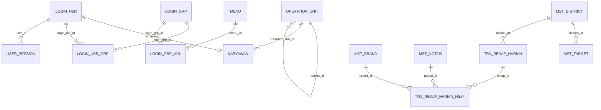

# Skema Database HSERA

> **Tujuan Dokumen**: Dokumen ini memuat dokumentasi menyeluruh skema database PostgreSQL platform HSERA. Sistem menggunakan dua database terpisah pada instance PostgreSQL yang sama (Port Host: `5433`).

---

## 1. Arsitektur Dual Database

| Nama Database | Pemilik Layanan | Deskripsi Entitas |
| :--- | :--- | :--- |
| **`hsera`** | `hsera-auth-backend` | Autentikasi pengguna, session, grup role, ACL perizinan menu, pohon hierarki Operation Unit, dan master data Karyawan. |
| **`hsera_salesmanship`** | `hsera-salesmanship-backend` | Master Teritori (District), Master Brand & Notasi, Master Target, Transaksi Rekap Callsheet Harian (RIS), dan Penguncian Periode Minggu. |

---

## 2. Diagram Relasi Entitas (ERD)

---

## 3. Database: `hsera` (Auth & Master)

### 1. `operation_unit`
Menyimpan struktur organisasi hierarki:
* `id` (`UUID`, PK)
* `code` (`VARCHAR(20)`, Unique) - Contoh: `HO`, `REG-JATIM`, `AREA-TAG`, `CAB-TAG`
* `name` (`VARCHAR(150)`) - Nama resmi unit kerja
* `category` (`VARCHAR(50)`) - Kategori label tampilan
* `type` (`VARCHAR(30)`) - Enum: `HEAD_OFFICE`, `REGIONAL`, `AREA_OFFICE`, `OPERATION_UNIT`
* `parent_id` (`UUID`, FK self-reference ke `operation_unit.id`)
* `path` (`VARCHAR(255)`) - Breadcrumb hierarki
* `level` (`INTEGER`) - Tingkat kedalaman pohon (1: HO, 2: Reg, 3: Area, 4: Cabang)
* `status` (`BOOLEAN`, Default: `true`)

### 2. `karyawan`
Data profil pegawai:
* `id` (`UUID`, PK)
* `employee_number` (`VARCHAR(50)`, Unique)
* `nik` (`VARCHAR(16)`)
* `legal_name` (`VARCHAR(150)`)
* `operation_unit_id` (`UUID`, FK ke `operation_unit.id`)
* `status` (`BOOLEAN`, Default: `true`)

### 3. `login_usr`
Akun kredensial sistem:
* `id` (`UUID`, PK)
* `username` (`VARCHAR(50)`, Unique)
* `passwd` (`VARCHAR(255)`) - Hash password (bcrypt / legacy SHA1)
* `jenis` (`VARCHAR(20)`) - `SA` (Super Admin) atau `pegawai`
* `id_relasi` (`VARCHAR(50)`) - Menyimpan UUID `karyawan.id`
* `aktif` (`INTEGER`, 1=Aktif, 0=Nonaktif)
* `tgl1`, `tgl2` (`TIMESTAMP`) - Rentang masa aktif akun

### 4. `login_grp` & `login_grp_acl`
Manajemen role dan tabel penghubung izin menu:
* `login_grp`: `id` (`UUID`, PK), `nama` (`VARCHAR(100)`), `aktif` (`INTEGER`)
* `login_grp_acl`:
  * `id` (`UUID`, PK)
  * `login_grp_id` (`UUID`, FK ke `login_grp.id`)
  * `menu_id` (`UUID`, FK ke `menu.id`)
  * `enable` (`INTEGER`, 1=Aktif)
  * `level` (`INTEGER`) - Angka bitmask level otorisasi (`1111`)

### 5. `menu`
Katalog hierarki navigasi sidebar:
* `id` (`UUID`, PK) - Contoh UUID standar: `SYSTEM_MENU_IDS`
* `upline` (`UUID`, Nullable, FK ke `menu.id`)
* `urut` (`INTEGER`), `nama` (`VARCHAR(100)`), `tipe` (`Header` / `Detail`)
* `link` (`VARCHAR(100)`), `icon` (`VARCHAR(50)`), `aktif` (`INTEGER`)

### 6. `user_session`
Sesi login aktif dan refresh token:
* `id` (`UUID`, PK)
* `user_id` (`UUID`, FK ke `login_usr.id`)
* `refresh_token` (`VARCHAR(255)`)
* `user_agent`, `ip_address`
* `expires_at`, `created_at`

---

## 4. Database: `hsera_salesmanship` (Operasional)

### 1. `mst_district`
Teritori salesman lapangan:
* `id` (`UUID`, PK)
* `ou_kode` (`VARCHAR(20)`) - Kode unit cabang (contoh: `CAB-TAG`)
* `kode` (`VARCHAR(10)`) - Kode distrik (contoh: `D-01`, `D-02`)
* `karyawan_id` (`VARCHAR(50)`) - UUID karyawan salesman yang ditugaskan
* `status` (`VARCHAR(10)`, Default: `AKTIF`)
* **Constraint Unik**: `UNIQUE(ou_kode, kode)`

### 2. `mst_brand`
Katalog brand produk tembakau/rokok:
* `id` (`UUID`, PK)
* `kode` (`VARCHAR(20)`, Unique)
* `nama` (`VARCHAR(100)`)
* `kategori` (`VARCHAR(20)`)
* `urutan` (`INTEGER`) - Urutan penayangan pada formulir matriks
* `status` (`VARCHAR(10)`, Default: `AKTIF`)

### 3. `mst_notasi`
Kolom notasi rekap lapangan:
* `id` (`UUID`, PK)
* `kode` (`VARCHAR(50)`, Unique) - `OOS`, `SK`, `SL`, `SD`, `SB`, `TL`, `BPJ`
* `nama` (`VARCHAR(150)`)
* `level_input` (`VARCHAR(20)`) - `BRAND`, `HARIAN`, dll.
* `urutan` (`INTEGER`)
* `status` (`VARCHAR(10)`, Default: `AKTIF`)

### 4. `mst_target`
Target kuantitatif bulanan distrik:
* `id` (`UUID`, PK)
* `jenis_target` (`VARCHAR(20)`) - `VOLUME`, `EFFECTIVE_CALL`, `CALLMADE`, `BRAND_DISTRIBUTION`
* `district_id` (`UUID`, FK ke `mst_district.id`, `ON DELETE CASCADE`)
* `hari_kunjungan` (`SMALLINT`, Nullable) - 1..6 jika target spesifik per hari
* `nilai` (`DECIMAL(14, 2)`)
* `berlaku_dari` (`DATE`), `berlaku_sampai` (`DATE`, Nullable)
* `status` (`VARCHAR(10)`, Default: `AKTIF`)

### 5. `trx_rekap_harian`
Header rekap kunjungan harian per distrik:
* `id` (`UUID`, PK)
* `district_id` (`UUID`, FK ke `mst_district.id`, `ON DELETE RESTRICT`)
* `tgl_kunjungan` (`DATE`)
* `hari_kunjungan` (`SMALLINT`) - 1..6 (1=Senin, 6=Sabtu)
* `kode_minggu` (`INTEGER`) - `YYYYWW` (contoh: `202642`)
* `karyawan_id` (`VARCHAR(50)`), `ou_kode` (`VARCHAR(20)`)
* `jenis_rekap` (`VARCHAR(30)`) - `NORMAL` atau `TIDAK_ADA_KUNJUNGAN`
* `alasan` (`VARCHAR(150)`, Nullable)
* `jumlah_kunjungan` (`INTEGER`, Default: `0`)
* `total_ec` (`INTEGER`, Default: `0`)
* `bd_outlet` (`INTEGER`, Default: `0`)
* `volume_gg` (`DECIMAL(14, 2)`, Nullable)
* `status_rekap` (`VARCHAR(20)`) - `DRAFT` atau `FINAL`
* `catatan` (`TEXT`, Nullable)

### 6. `trx_rekap_harian_nilai`
Detail sel matriks per brand $\times$ notasi:
* `id` (`UUID`, PK)
* `rekap_id` (`UUID`, FK ke `trx_rekap_harian.id`, `ON DELETE CASCADE`)
* `brand_id` (`UUID`, FK ke `mst_brand.id`, `ON DELETE RESTRICT`)
* `notasi_id` (`UUID`, FK ke `mst_notasi.id`, `ON DELETE RESTRICT`)
* `nilai` (`DECIMAL(14, 2)`, Default: `0`)
* **Constraint Unik**: `UNIQUE(rekap_id, brand_id, notasi_id)`

### 7. `sys_kunci_minggu`
Kunci periode operasional mingguan:
* `kode_minggu` (`INTEGER`, PK) - Format `YYYYWW`
* `status` (`VARCHAR(10)`) - `AKTIF` (*Locked*) atau `NONAKTIF` (*Unlocked*)
* `catatan` (`TEXT`, Nullable)
* `created_at`, `updated_at`
