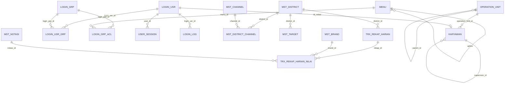

# Skema Database HSERA

> **Tujuan Dokumen**: Dokumen ini memuat dokumentasi teknis menyeluruh skema database PostgreSQL platform HSERA. Sistem menggunakan arsitektur dua database terpisah (*Dual Database*) pada instance PostgreSQL yang sama (Port Host default: `5433`).

---

## 1. Arsitektur Dual Database

| Nama Database | Pemilik Layanan | Deskripsi Entitas & Tanggung Jawab |
| :--- | :--- | :--- |
| **`hsera`** | `hsera-auth-backend` | Autentikasi pengguna, session token, grup role, ACL perizinan menu, pohon hierarki unit kerja (*Operation Unit*), master data Karyawan, dan informasi payroll perbankan. |
| **`hsera_salesmanship`** | `hsera-salesmanship-backend` | Master Teritori (*District*), Channel Distribusi (*Agen, Wholesale, Retail, MTI*), Master Brand & Notasi, Master Target kuantitatif, Transaksi Rekap Callsheet Harian (RIS), dan Penguncian Periode Minggu. |

---

## 2. Diagram Relasi Entitas (ERD)

---

## 3. Database: `hsera` (Auth, Organisasi & Profil Karyawan)

### 3.1. `operation_unit`
Menyimpan struktur organisasi hierarki berjenjang (Head Office, Regional, Area Office, Cabang):
* `id` (`UUID`, PK)
* `parent_id` (`UUID`, Nullable, FK self-reference ke `operation_unit.id`, `ON DELETE RESTRICT`)
* `code` (`VARCHAR(50)`, Unique) — Kode unik unit (contoh: `HO`, `REG-JATIM`, `AREA-TAG`, `CAB-TAG`, `CAB-TGK`)
* `name` (`VARCHAR(150)`) — Nama resmi unit kerja (contoh: `Cabang Tulungagung`, `Cabang Trenggalek`)
* `type` (`VARCHAR(50)`) — Tingkatan hierarki:
  - `HEAD_OFFICE` (Level 1: Kantor Pusat)
  - `REGIONAL` (Level 2: Kantor Regional Wilayah)
  - `AREA_OFFICE` (Level 3: Kantor Area Pengawas)
  - `OPERATION_UNIT` (Level 4: Titik Distribusi / Cabang Operasional)
* `category` (`VARCHAR(50)`, Nullable) — Kategori klasifikasi unit
* `distribution_point` (`VARCHAR(100)`, Nullable) — Titik sebaran logistik
* `address` (`TEXT`, Nullable) — Alamat fisik kantor/depo
* `province_id`, `city_id`, `district_id`, `village_id` (`UUID`, Nullable) — Relasi data wilayah administrasi
* `postal_code` (`VARCHAR(10)`, Nullable), `phone` (`VARCHAR(30)`, Nullable)
* `latitude` (`DECIMAL(10, 8)`, Nullable), `longitude` (`DECIMAL(11, 8)`, Nullable) — Koordinat geografis
* `building_status` (`VARCHAR(30)`, Nullable) — Status aset (Milik Sendiri / Sewa)
* `lease_category` (`VARCHAR(30)`, Nullable), `lease_start_date` (`DATE`, Nullable), `lease_end_date` (`DATE`, Nullable)
* `annual_rent` (`DECIMAL(15, 2)`, Nullable) — Biaya sewa tahunan
* `legal_document_type` (`VARCHAR(50)`, Nullable), `legal_document_number` (`VARCHAR(100)`, Nullable)
* `status` (`BOOLEAN`, Default: `true`) — Status keaktifan unit
* `created_at` (`TIMESTAMP(3)`, Default: `now()`), `created_by` (`UUID`, Nullable)
* `updated_at` (`TIMESTAMP(3)`), `updated_by` (`UUID`, Nullable)

### 3.2. `karyawan`
Menyimpan master data profil pegawai, penempatan kerja, atasan langsung, dan informasi perbankan (payroll):
* `id` (`UUID`, PK)
* `operation_unit_id` (`UUID`, FK ke `operation_unit.id`, `ON DELETE RESTRICT`) — Cabang/unit penempatan resmi
* `division_id` (`UUID`, Nullable) — Divisi kerja pegawai
* `supervisor_id` (`UUID`, Nullable, FK self-reference ke `karyawan.id`, `ON DELETE SET NULL`) — Atasan langsung (hierarki manajerial)
* `employee_number` (`VARCHAR(50)`, Unique) — Nomor Induk Pegawai (NIP / Employee ID)
* `nik` (`VARCHAR(20)`, Unique) — Nomor Induk Kependudukan (16 digit KTP)
* `legal_name` (`VARCHAR(150)`) — Nama lengkap pegawai sesuai identitas resmi
* `email` (`VARCHAR(100)`, Unique, Nullable) — Email korespondensi
* `phone` (`VARCHAR(30)`, Nullable) — Nomor telepon / WhatsApp
* `sex` (`VARCHAR(20)`, Nullable) — Jenis kelamin (`L` / `P` / `Laki-laki` / `Perempuan`)
* `marital_status` (`VARCHAR(30)`, Nullable) — Status perkawinan
* `religion` (`VARCHAR(30)`, Nullable) — Agama
* `place_of_birth` (`VARCHAR(100)`, Nullable), `date_of_birth` (`DATE`, Nullable)
* `last_education` (`VARCHAR(50)`, Nullable) — Pendidikan terakhir
* `address` (`TEXT`, Nullable), `postal_code` (`VARCHAR(10)`, Nullable)
* `province_id`, `city_id`, `district_id`, `village_id` (`UUID`, Nullable)
* `original_date_of_hire` (`DATE`, Nullable) — Tanggal mulai bekerja pertama kali
* `permanent_date` (`DATE`, Nullable) — Tanggal pengangkatan sebagai karyawan tetap
* `actual_termination_date` (`DATE`, Nullable) — Tanggal pengunduran diri / terminasi
* `bank_id` (`UUID`, Nullable) — Identifikasi Master Bank Indonesia (mendukung format UUID deterministik kode kliring BI 140+ bank nasional, swasta, BPD, digital, dan syariah)
* `account_name` (`VARCHAR(100)`, Nullable) — Nama pemilik rekening payroll
* `account_number` (`VARCHAR(50)`, Nullable) — Nomor rekening bank pegawai
* `status` (`BOOLEAN`, Default: `true`) — Status kerja aktif/nonaktif
* `created_at` (`TIMESTAMP(3)`, Default: `now()`), `created_by` (`UUID`, Nullable)
* `updated_at` (`TIMESTAMP(3)`), `updated_by` (`UUID`, Nullable)

### 3.3. `login_usr`
Akun autentikasi dan kredensial login sistem:
* `id` (`UUID`, PK)
* `username` (`VARCHAR(50)`, Unique) — Username login sistem
* `passwd` (`VARCHAR(100)`) — Hash kata sandi terenkripsi (BCrypt / kompatibel SHA-1 legacy)
* `aktif` (`SMALLINT`, Default: `1`) — 1 = Aktif, 0 = Nonaktif/Terkunci
* `tgl_1` (`DATE`), `tgl_2` (`DATE`) — Rentang masa berlaku akun
* `jenis` (`VARCHAR(50)`) — Tipe akun: `SA` (Super Administrator mandiri) atau `pegawai` (terhubung profil fisik)
* `id_relasi` (`UUID`, Unique, Nullable, FK ke `karyawan.id`, `ON DELETE SET NULL`) — Relasi ke profil karyawan

### 3.4. `login_grp` & `login_usr_grp`
Manajemen role (kelompok pengguna) dan pemetaan banyak-ke-banyak (*many-to-many*):
* `login_grp`:
  * `id` (`UUID`, PK)
  * `nama` (`VARCHAR(100)`) — Nama role (contoh: `Super Admin`, `Area Manager`, `Admin Distribusi`, `Salesman`, `Staff HR`)
  * `aktif` (`SMALLINT`, Default: `1`)
* `login_usr_grp`:
  * `id` (`UUID`, PK)
  * `login_usr_id` (`UUID`, FK ke `login_usr.id`, `ON DELETE CASCADE`)
  * `login_grp_id` (`UUID`, FK ke `login_grp.id`, `ON DELETE CASCADE`)

### 3.5. `menu` & `login_grp_acl`
Daftar navigasi sidebar dan Access Control List (ACL) berbasis izin peran:
* `menu`:
  * `id` (`UUID`, PK) — Menggunakan UUID statis sistem ([`SYSTEM_MENU_IDS`](file:///Users/dyra/Documents/Docker/hsera/hsera-dashboard/src/core/constants/MenuConstants.ts))
  * `upline` (`UUID`, Nullable, FK self-reference ke `menu.id`, `ON DELETE CASCADE`) — Menu induk
  * `urut` (`SMALLINT`, Default: `0`) — Urutan penayangan menu
  * `nama` (`VARCHAR(255)`) — Label menu
  * `tipe` (`VARCHAR(10)`) — `Header` (menu induk/grup) atau `Detail` (item rute)
  * `level` (`SMALLINT`, Default: `1`) — Kedalaman level menu
  * `link` (`VARCHAR(100)`, Default: `'#'`) — Path rute frontend
  * `icon` (`VARCHAR(40)`) — Identifier icon tampilan
  * `aktif` (`SMALLINT`, Default: `1`)
* `login_grp_acl`:
  * `id` (`UUID`, PK)
  * `login_grp_id` (`UUID`, FK ke `login_grp.id`, `ON DELETE CASCADE`)
  * `menu_id` (`UUID`, FK ke `menu.id`, `ON DELETE CASCADE`)
  * `enable` (`SMALLINT`, Default: `1`) — Izin akses menu (1 = Aktif)
  * `level` (`SMALLINT`, Default: `0`) — Bitmask hak akses granular (Lihat, Tambah, Edit, Hapus)

### 3.6. `user_session`
Penyimpanan sesi login aktif dan siklus hidup JWT refresh token:
* `id` (`UUID`, PK)
* `user_id` (`UUID`, FK ke `login_usr.id`, `ON DELETE CASCADE`)
* `refresh_token_hash` (`VARCHAR(255)`) — Hash token sesi
* `ip_address` (`VARCHAR(45)`, Nullable) — Alamat IP klien
* `user_agent` (`TEXT`, Nullable) — Informasi browser/perangkat
* `is_revoked` (`BOOLEAN`, Default: `false`) — Status pembatalan/revokasi sesi
* `expires_at` (`TIMESTAMP(3)`) — Waktu kedaluwarsa sesi
* `created_at` (`TIMESTAMP(3)`, Default: `now()`), `updated_at` (`TIMESTAMP(3)`)

### 3.7. `login_log`
Audit trail pencatatan aktivitas login dan interaksi sistem:
* `id` (`UUID`, PK)
* `login_usr_id` (`UUID`, FK ke `login_usr.id`, `ON DELETE CASCADE`)
* `menu_id` (`UUID`, Nullable, FK ke `menu.id`, `ON DELETE SET NULL`)
* `menu_nama` (`VARCHAR(100)`, Nullable)
* `status` (`VARCHAR(100)`) — Jenis aktivitas (contoh: `LOGIN_SUCCESS`, `LOGOUT`, `ACCESS_MENU`)
* `tabel_relasi` (`VARCHAR(100)`, Nullable), `id_relasi` (`VARCHAR(50)`, Nullable)
* `created_at` (`TIMESTAMP(3)`, Default: `now()`)

---

## 4. Database: `hsera_salesmanship` (Operasional & Transaksi RIS)

### 4.1. `mst_district`
Master teritori penjualan salesman per cabang:
* `id` (`UUID`, PK)
* `ou_kode` (`VARCHAR(20)`) — Kode cabang induk (contoh: `CAB-TAG`, `CAB-TGK`)
* `kode` (`VARCHAR(10)`) — Kode teritori distrik (contoh: `D-01`, `D-07`, `D-10`)
* `karyawan_id` (`VARCHAR(50)`) — UUID karyawan salesman yang ditugaskan (terhubung ke `hsera.karyawan.id`)
* `status` (`VARCHAR(10)`, Default: `'AKTIF'`) — `AKTIF` atau `NONAKTIF`
* `created_at` (`TIMESTAMP(6)`, Default: `now()`), `created_by` (`VARCHAR(50)`, Nullable)
* `updated_at` (`TIMESTAMP(6)`), `updated_by` (`VARCHAR(50)`, Nullable)
* **Constraint Unik**: `UNIQUE(ou_kode, kode)`

### 4.2. `mst_channel`
Katalog klasifikasi saluran distribusi penjualan:
* `id` (`UUID`, PK)
* `kode` (`VARCHAR(20)`, Unique) — Kode saluran: `AGEN`, `WHOLESALE`, `RETAIL`, `MTI`
* `nama` (`VARCHAR(100)`) — Nama saluran perdagangan
* `deskripsi` (`TEXT`, Nullable)
* `urutan` (`INTEGER`, Default: `1`) — Urutan tampilan
* `status` (`VARCHAR(10)`, Default: `'AKTIF'`)
* `created_at` (`TIMESTAMP(6)`, Default: `now()`), `created_by` (`VARCHAR(50)`, Nullable)
* `updated_at` (`TIMESTAMP(6)`), `updated_by` (`VARCHAR(50)`, Nullable)

### 4.3. `mst_district_channel`
Tabel relasi banyak-ke-banyak (*junction table*) antara Teritori Distrik dan Saluran Perdagangan:
* `district_id` (`UUID`, Composite PK, FK ke `mst_district.id`, `ON DELETE CASCADE`)
* `channel_id` (`UUID`, Composite PK, FK ke `mst_channel.id`, `ON DELETE RESTRICT`)
* `created_at` (`TIMESTAMP(6)`, Default: `now()`)

### 4.4. `mst_brand`
Katalog brand produk rokok/tembakau:
* `id` (`UUID`, PK)
* `kode` (`VARCHAR(20)`, Unique) — Kode identifikasi brand (contoh: `GG_SURYA`, `GG_FILTER`, `GG_MERAH`)
* `nama` (`VARCHAR(100)`) — Nama lengkap brand
* `kategori` (`VARCHAR(20)`) — Kategori produk (contoh: `SKM`, `SKT`, dll.)
* `urutan` (`INTEGER`, Default: `1`) — Urutan kolom dalam formulir matriks rekap
* `status` (`VARCHAR(10)`, Default: `'AKTIF'`)
* `created_at` (`TIMESTAMP(6)`, Default: `now()`), `created_by` (`VARCHAR(50)`, Nullable)
* `updated_at` (`TIMESTAMP(6)`), `updated_by` (`VARCHAR(50)`, Nullable)

### 4.5. `mst_notasi`
Katalog jenis notasi pencatatan lapangan:
* `id` (`UUID`, PK)
* `kode` (`VARCHAR(50)`, Unique) — Kode notasi:
  - `SK` (Stock Akhir Toko)
  - `SL` (Sales / Penjualan)
  - `OOS` (Out Of Stock / Habis)
  - `SD` (Stock Display)
  - `TL` (Toko Langganan)
  - `BPJ` (Barang Pajang)
  - `SB` (Stock Baik)
* `nama` (`VARCHAR(150)`) — Label deskripsi notasi
* `level_input` (`VARCHAR(20)`) — `BRAND`, `HARIAN`, `TURUNAN`, atau `TARGET`
* `kelompok_tampil` (`VARCHAR(20)`, Nullable) — `STATUS`, `KUANTITAS`, `FACEUP`, `HARIAN`
* `rumus` (`VARCHAR(200)`, Nullable) — Formula kalkulasi otomatis jika notasi turunan
* `satuan` (`VARCHAR(20)`) — Satuan pengukuran (`OUTLET`, `QTY`, `PACK`)
* `urutan` (`INTEGER`, Default: `1`)
* `status` (`VARCHAR(10)`, Default: `'AKTIF'`)
* `created_at` (`TIMESTAMP(6)`, Default: `now()`), `created_by` (`VARCHAR(50)`, Nullable)
* `updated_at` (`TIMESTAMP(6)`), `updated_by` (`VARCHAR(50)`, Nullable)

### 4.6. `mst_target`
Konfigurasi target performa penjualan salesmen yang mendukung hirarki 3 tingkatan:
* `id` (`UUID`, PK)
* `jenis_target` (`VARCHAR(20)`) — Parameter KPI target:
  - `KUNJUNGAN` (Target Callmade / Jumlah Toko Dikunjungi)
  - `BD` (Target Brand Distribution Outlet)
  - `EC` (Target Effective Call / Transaksi Berhasil)
  - `FACEUP` (Target Kerapian Display Produk)
  - `VOLUME` (Target Kuantitas Penjualan dalam satuan Pack / Pk)
* `ou_kode` (`VARCHAR(20)`, Nullable) — Kode Unit Cabang (contoh: `CAB-TAG`, `CAB-TGK`).
  - Jika `ou_kode` terisi dan `district_id` kosong (`NULL`), target berlaku sebagai acuan umum (*baseline*) untuk **seluruh district di cabang tersebut**.
* `district_id` (`UUID`, Nullable, FK ke `mst_district.id`, `ON DELETE CASCADE`) — Jika diisi, berfungsi sebagai penentu target khusus (*override*) **hanya untuk district bersangkutan**.
* `hari_kunjungan` (`SMALLINT`, Nullable) — Cakupan hari target:
  - `1`..`6` = Spesifik hari tertentu (1 = Senin s/d 6 = Sabtu)
  - `7` = Khusus hari kerja Senin s/d Jumat
  - `NULL` = Berlaku untuk Semua Hari (flat)
* `nilai` (`DECIMAL(14, 2)`) — Nominal target kuantitatif
* `berlaku_dari` (`DATE`), `berlaku_sampai` (`DATE`, Nullable) — Masa berlaku target
* `status` (`VARCHAR(10)`, Default: `'AKTIF'`) — `AKTIF` atau `NONAKTIF`
* `created_at` (`TIMESTAMP(6)`, Default: `now()`), `created_by` (`VARCHAR(50)`, Nullable)
* `updated_at` (`TIMESTAMP(6)`), `updated_by` (`VARCHAR(50)`, Nullable)

> [!NOTE]
> **Hirarki Resolusi Target (*Cascading Priority*)**:
> 1. Target Spesifik District (`district_id` cocok)
> 2. Target Baseline Unit Cabang (`ou_kode` cocok & `district_id IS NULL`)
> 3. Target Global Perusahaan (`ou_kode IS NULL` & `district_id IS NULL`)
> 4. Fallback Standar Sistem (`KUNJUNGAN: 40`, `EC: 30`, `BD: 20`, `VOLUME: 0`)

### 4.7. `trx_rekap_harian`
Header transaksi lembar kerja callsheet harian (1 salesman $\times$ 1 hari kerja):
* `id` (`UUID`, PK)
* `district_id` (`UUID`, FK ke `mst_district.id`, `ON DELETE RESTRICT`)
* `tgl_kunjungan` (`DATE`) — Tanggal pelaksanaan kunjungan
* `hari_kunjungan` (`SMALLINT`) — Hari ke-1 s/d 6 (1 = Senin, 6 = Sabtu)
* `kode_minggu` (`INTEGER`) — Format kalender ISO `YYYYWW` (contoh: `202644`)
* `karyawan_id` (`VARCHAR(50)`) — UUID salesman pelaksana
* `ou_kode` (`VARCHAR(20)`) — Kode unit cabang saat transaksi berlangsung
* `jenis_rekap` (`VARCHAR(30)`, Default: `'NORMAL'`) — `NORMAL` atau `TIDAK_ADA_KUNJUNGAN`
* `alasan` (`VARCHAR(150)`, Nullable) — Alasan keterangan jika tidak ada kunjungan (izin/libur)
* `jumlah_kunjungan` (`INTEGER`, Default: `0`) — Realisasi Callmade (CM)
* `total_ec` (`INTEGER`, Default: `0`) — Realisasi Effective Call (EC)
* `bd_outlet` (`INTEGER`, Default: `0`) — Realisasi Brand Distribution Outlet (BD)
* `total_volume` (`DECIMAL(14, 2)`, Nullable) — Akumulasi volume penjualan (Pack)
* `status_rekap` (`VARCHAR(20)`, Default: `'DRAFT'`) — Status verifikasi: `DRAFT` atau `FINAL`
* `status` (`VARCHAR(10)`, Default: `'AKTIF'`) — Status keaktifan record
* `catatan` (`TEXT`, Nullable) — Catatan supervisi
* `created_at` (`TIMESTAMP(6)`, Default: `now()`), `created_by` (`VARCHAR(50)`, Nullable)
* `updated_at` (`TIMESTAMP(6)`), `updated_by` (`VARCHAR(50)`, Nullable)

### 4.8. `trx_rekap_harian_nilai`
Rincian kuantitas pada matriks brand $\times$ notasi per rekap harian:
* `id` (`UUID`, PK)
* `rekap_id` (`UUID`, FK ke `trx_rekap_harian.id`, `ON DELETE CASCADE`)
* `brand_id` (`UUID`, FK ke `mst_brand.id`, `ON DELETE RESTRICT`)
* `notasi_id` (`UUID`, FK ke `mst_notasi.id`, `ON DELETE RESTRICT`)
* `nilai` (`DECIMAL(14, 2)`, Default: `0`) — Angka isian kuantitas/outlet
* `status` (`VARCHAR(10)`, Default: `'AKTIF'`)
* `created_at` (`TIMESTAMP(6)`, Default: `now()`), `created_by` (`VARCHAR(50)`, Nullable)
* `updated_at` (`TIMESTAMP(6)`), `updated_by` (`VARCHAR(50)`, Nullable)
* **Constraint Unik**: `UNIQUE(rekap_id, brand_id, notasi_id)`

### 4.9. `sys_kunci_minggu`
Audit kendali integritas data dan penguncian periode mingguan oleh Supervisor / Admin:
* `kode_minggu` (`INTEGER`, PK) — Kode minggu ISO `YYYYWW` (contoh: `202644`)
* `status` (`VARCHAR(10)`, Default: `'AKTIF'`) — `AKTIF` (*Locked* / Terkunci) atau `NONAKTIF` (*Unlocked* / Terbuka)
* `catatan` (`TEXT`, Nullable) — Alasan pembukaan/penguncian periode
* `created_at` (`TIMESTAMP(6)`, Default: `now()`), `created_by` (`VARCHAR(50)`, Nullable)
* `updated_at` (`TIMESTAMP(6)`), `updated_by` (`VARCHAR(50)`, Nullable)
