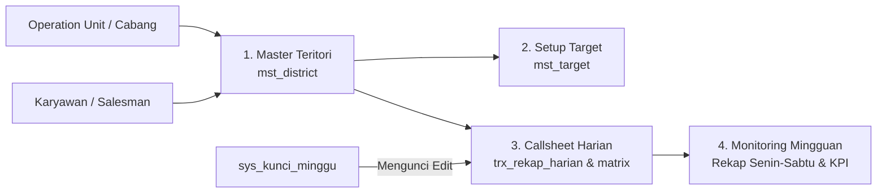

# Modul Salesmanship & Callsheet RIS

> **Tujuan Dokumen**: Dokumen ini membedah seluruh aturan bisnis, rumus perhitungan matematis, struktur data matrix, dan spesifikasi fitur operasional lapangan pada modul Salesmanship HSERA.

---

## 1. Peta Submodul Salesmanship

Modul Salesmanship terdiri dari 4 fitur utama yang saling terhubung:



---

## 2. Master Teritori (District Management)

* **Path Route**: `/salesmanship/territory`
* **File Utama**: [TerritoryListPage.tsx](file:///Users/dyra/Documents/Docker/hsera/hsera-dashboard/src/presentation/pages/Salesmanship/Territory/TerritoryListPage.tsx), [useTerritory.ts](file:///Users/dyra/Documents/Docker/hsera/hsera-dashboard/src/presentation/pages/Salesmanship/Territory/hooks/useTerritory.ts)
* **Tabel Database**: `mst_district` (Database `hsera_salesmanship`)

### Aturan Bisnis & Validasi:
1. **Identitas Distrik**: Setiap distrik merepresentasikan wilayah edar penjualan lapangan (contoh: `D-01`, `D-02`).
2. **Kombinasi Unik**: Kode distrik bersifat unik di dalam satu Cabang (`ou_kode, kode`).
3. **Penugasan Salesman**: Satu distrik ditugaskan kepada satu salesman (relasi ke `karyawan.id` pada database `hsera`).
4. **Status**: `AKTIF` atau `NONAKTIF`. Hanya distrik `AKTIF` yang muncul pada formulir callsheet dan monitoring mingguan.

---

## 3. Setup Target Bulanan

* **Path Route**: `/salesmanship/target`
* **File Utama**: [TargetListPage.tsx](file:///Users/dyra/Documents/Docker/hsera/hsera-dashboard/src/presentation/pages/Salesmanship/Target/TargetListPage.tsx), [useTarget.ts](file:///Users/dyra/Documents/Docker/hsera/hsera-dashboard/src/presentation/pages/Salesmanship/Target/hooks/useTarget.ts)
* **Tabel Database**: `mst_target` (Database `hsera_salesmanship`)

Target ditetapkan per distrik per periode bulan & tahun.

### 4 Jenis Target Penjualan:
| Kode Target | Nama Target | Satuan Nilai | Penjelasan |
| :--- | :--- | :---: | :--- |
| `VOLUME` | Target Volume GG | Pack (Pk) | Target kuantitas rokok Gudang Garam (satuan pack/bungkus) yang wajib terjual. |
| `EFFECTIVE_CALL` | Target EC | Outlet | Target jumlah outlet unik yang melakukan transaksi pembelian riil. |
| `CALLMADE` | Target Callmade | Kunjungan | Target total kunjungan fisik yang harus dilakukan salesman ke outlet. |
| `BRAND_DISTRIBUTION` | Target BD Outlet | Outlet | Target sebaran outlet yang mendisplaikan stok produk secara efektif. |

---

## 4. Rekap Callsheet Harian (RIS)

* **Path Route**: `/salesmanship/callsheet`
* **File Utama**: [CallsheetFormPage.tsx](file:///Users/dyra/Documents/Docker/hsera/hsera-dashboard/src/presentation/pages/Salesmanship/Callsheet/CallsheetFormPage.tsx), [useCallsheetForm.ts](file:///Users/dyra/Documents/Docker/hsera/hsera-dashboard/src/presentation/pages/Salesmanship/Callsheet/hooks/useCallsheetForm.ts), [CallsheetMatrixTable.tsx](file:///Users/dyra/Documents/Docker/hsera/hsera-dashboard/src/presentation/pages/Salesmanship/Callsheet/components/CallsheetMatrixTable.tsx)
* **Tabel Database**: `trx_rekap_harian`, `trx_callsheet_matrix`

Fitur ini digunakan untuk merekam aktivitas harian salesman di lapangan berdasarkan formulir RIS (*Retail Information System*).

### 1. Mode Rekap (`jenisRekap`):
* **`NORMAL`**: Salesman bertugas ke lapangan dan merekap data toko.
* **`TIDAK_ADA_KUNJUNGAN`**: Hari kerja di mana salesman tidak berkunjung (Izin, Sakit, Cuti, Libur Nasional, Kendaraan Rusak). Field `alasan` wajib diisi; tabel matriks produk diisi angka 0 otomatis.

### 2. Status Rekap (`statusRekap`):
* **`DRAFT`**: Draft sementara (dapat disimpan walau data belum 100% lengkap).
* **`FINAL`**: Rekap resmi hari itu telah divalidasi dan dihitung sebagai capaian kelengkapan mingguan.

### 3. Matriks Produk $\times$ Notasi:
Setiap baris mewakili Brand Rokok (misal: Surya 16, GG Merah, GSP, dll), dan kolom mewakili Notasi Lapangan:

| Notasi | Singkatan | Definisi Operasional |
| :---: | :--- | :--- |
| **OOS** | *Out of Stock* | Outlet kehabisan persediaan stok produk tersebut saat dikunjungi. |
| **SK** | *Stok Kurang* | Stok produk di bawah batas aman minimun outlet. |
| **SL** | *Stok Lebih* | Stok produk berlebih/menumpuk di outlet. |
| **SD** | *Stok Diterima* | Stok kiriman baru yang baru saja diterima outlet. |
| **SB** | *Stok Baik* | Stok produk dalam kondisi cukup dan layak jual. |
| **TL** | *Tidak Laku* | Produk tidak bergerak / lambat perputarannya di outlet. |
| **BPJ** | *Beli Pada Jumlah* | Outlet melakukan transaksi pembelian sejumlah pack/slop. |

### 4. Rumus & Validasi Matriks:

$$\text{Total Status per Brand} = SK + SL + SD + OOS + SB + TL + BPJ$$

* **Validasi Jumlah Kunjungan**:
  $$\text{Selisih Baris} = \text{Total Status per Brand} - \text{Jumlah Kunjungan Hari Itu}$$
  * $\text{Selisih} = 0$: Valid (*Match*).
  * $\text{Selisih} > 0$: **Over** (Total status melebihi kunjungan toko, tidak valid).
  * $\text{Selisih} < 0$: **Under** (Kurang, diperbolehkan saat status DRAFT).

* **Brand Distribution (BD Outlet)**:
  Jumlah outlet yang memiliki persediaan/memajang brand tersebut:
  $$BD = OOS + SK + SL + SD + SB$$

* **Effective Call (EC)**:
  Jumlah outlet yang melakukan transaksi order/pembelian produk ($BUY$ / $BPJ$).

### 5. Pencegahan Masalah UX (Input Number Wheel):
Seluruh field angka pada matriks [CallsheetMatrixTable.tsx](file:///Users/dyra/Documents/Docker/hsera/hsera-dashboard/src/presentation/pages/Salesmanship/Callsheet/components/CallsheetMatrixTable.tsx) dilengkapi handler pencegah perubahan nilai secara tidak sengaja saat tabel discroll:
```tsx
onWheel={(e) => e.currentTarget.blur()}
```

---

## 5. Monitoring Callsheet Mingguan

* **Path Route**: `/salesmanship/monitoring`
* **File Utama**: [MonitoringPage.tsx](file:///Users/dyra/Documents/Docker/hsera/hsera-dashboard/src/presentation/pages/Salesmanship/Monitoring/MonitoringPage.tsx), [useWeeklyMonitoring.ts](file:///Users/dyra/Documents/Docker/hsera/hsera-dashboard/src/presentation/pages/Salesmanship/Monitoring/hooks/useWeeklyMonitoring.ts), [MonitoringWeekFilter.tsx](file:///Users/dyra/Documents/Docker/hsera/hsera-dashboard/src/presentation/pages/Salesmanship/Monitoring/components/MonitoringWeekFilter.tsx)
* **Tabel Database**: Membaca agregat `trx_rekap_harian`, `mst_district`, dan `sys_kunci_minggu`.

### 1. Penomoran Minggu ISO (`kodeMinggu`):
Format angka integer 6-digit: `YYYYWW` (contoh: `202642` = Tahun 2026, Minggu ke-42).
Dihitung menggunakan algoritma ISO-8601 di mana minggu pertama tahun baru adalah minggu yang memuat hari Kamis pertama di bulan Januari.

### 2. Defaulting Otomatis ke OU Pengguna:
Ketika halaman monitoring dibuka, nilai filter unit operasional otomatis mengambil `user.scope.unitCode` pengguna yang sedang login. Pengguna cabang tidak perlu memilih dropdown cabang secara manual setiap membuka fitur.

### 3. Matriks 6 Hari Kerja (Senin s/d Sabtu):
Monitoring memetakan 6 hari kerja operasional (Hari 1 = Senin, Hari 6 = Sabtu).

Indikator Sel Matriks:
* 🟢 **Hijau (FINAL / LENGKAP)**: Kunjungan terisi dan berstatus FINAL.
* 🟡 **Kuning (DRAFT)**: Masih berupa draft dan menunggu finalisasi.
* ⚪ **Abu-abu (KOSONG)**: Belum ada rekap callsheet yang diinput untuk hari tersebut.
* 🔵 **Biru (TIDAK ADA KUNJUNGAN)**: Izin/Sakit/Libur yang sudah terverifikasi FINAL (dihitung lengkap/dimaafkan).

### 4. Kartu KPI Agregat Mingguan:
1. **Kelengkapan Rekap**:
   $$\% \text{ Kelengkapan} = \left( \frac{\text{Total Hari FINAL}}{\text{Total Distrik Aktif} \times 6} \right) \times 100\%$$
2. **Total Effective Call (EC)**: Akumulasi outlet beli sepanjang minggu.
3. **Total Brand Distribution (BD Outlet)**: Akumulasi sebaran outlet aktif.
4. **Total Volume GG**: Akumulasi penjualan rokok dalam minggu tersebut.

### 5. Sistem Penguncian Periode Minggu (`sys_kunci_minggu`):
* Admin/Supervisor dapat menekan tombol **"Kunci Periode Minggu"**.
* Ketika status minggu `LOCKED`, seluruh rekap harian pada minggu tersebut otomatis berstatus *read-only*. Pengguna tidak dapat mengedit atau menghapus data callsheet pada minggu yang terkunci.
